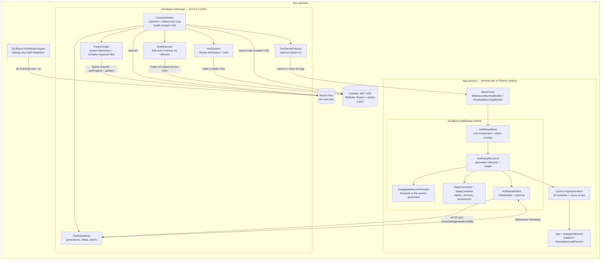
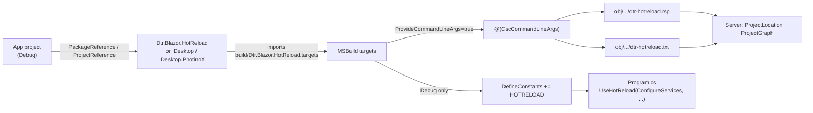
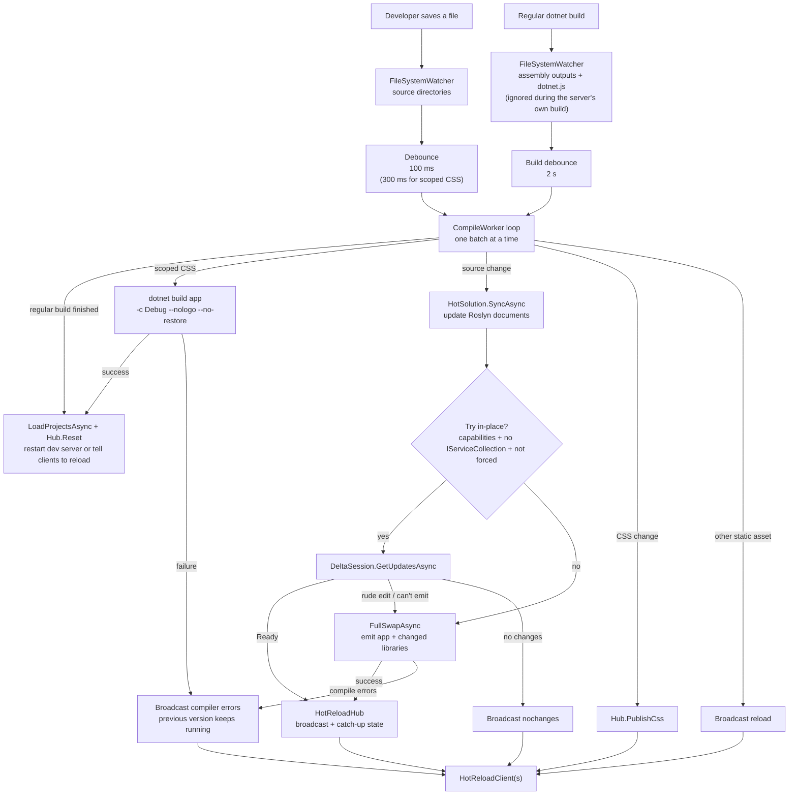
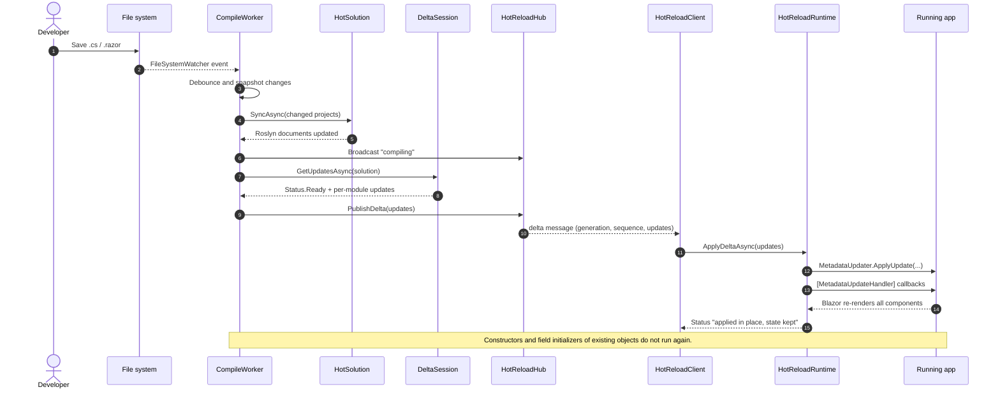
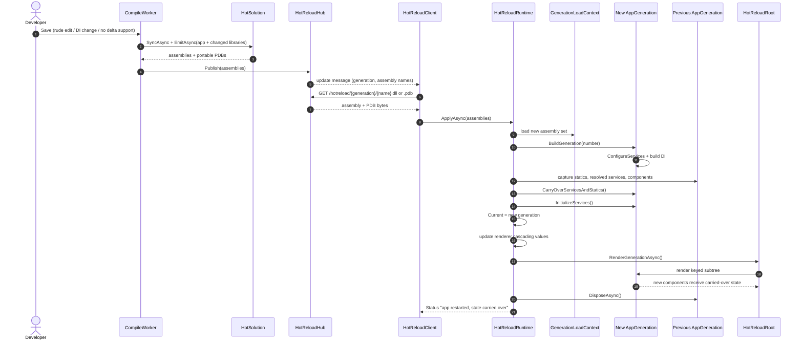
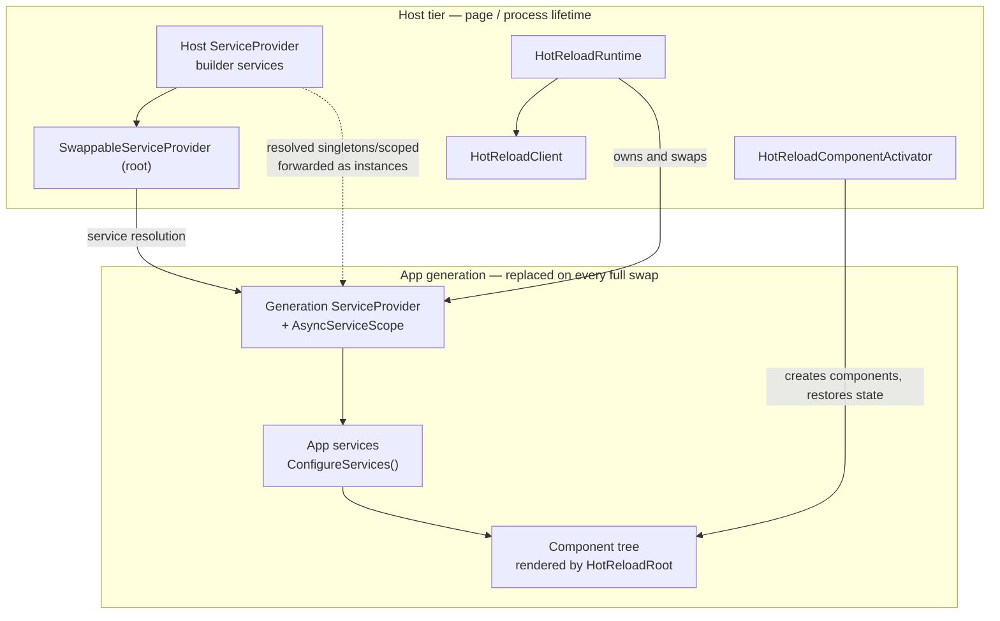

# Architecture

Hot reload is split into two processes:

- **The app process** (a browser tab, or a Photino/PhotinoX desktop window) runs the `Dtr.Blazor.HotReload` runtime and connects to the server.
- **The server process** (`dtr-blazor-hotreload`) watches the app's source, compiles changes, and sends either in-place
  metadata updates or complete new generations over a WebSocket.

The normal build output is the starting point ("generation 0"). The server never mutates the app's `bin/` output; all hot
reload artifacts are compiled in memory (and, for the delta baseline, cached under the app's `obj/` directory).

## System overview

On disk, the app and server only share the app's build output and the files the build targets leave in `obj/`. The app
does not reference the server assembly, and the server does not load the app assembly.

## Build-time integration

The app references one of the runtime packages only in Debug builds. The package's targets define `HOTRELOAD` and capture
the exact compiler command line of the app, so the server can reproduce the build with the same references, source
generators (including Razor), defines, and analyzer settings.

For the app, the server reads the response file from the last regular build. For referenced libraries it asks MSBuild for
their compiler command lines with a design-time query, so the libraries do not need any build changes. This is also why a
regular `dotnet build` is only required when the project graph, references, packages, or anything generated at build time
changes. Scoped CSS is generated at build time too, but the server handles that itself: a saved `.razor.css`/`.cshtml.css`
triggers a build, then a reset (see below).

## Server pipeline

`CompileWorker` is the single writer. File watchers and WebSocket messages only add to sets under a lock and signal the
loop; the loop takes a snapshot, handles one batch, and repeats. That keeps compiles serialized and lets changes that arrive
during a compile be handled next.

Important server-side details:

- **Project graph** — `ProjectGraph` finds the app's project references, orders them dependencies-first, and obtains each
  project's compiler response file. Projects that are part of the hot reload machinery are excluded.
- **Roslyn workspace** — `HotSolution` keeps source and Razor documents in sync with disk, loads Roslyn from the SDK (so it
  matches the SDK's Razor generator), and emits assemblies for either deltas or full swaps.
- **Scoped CSS** — scoped CSS is generated by the SDK at build time (the scope attributes and the bundled stylesheet), so the
  in-memory compiler can't apply it. A saved `.razor.css`/`.cshtml.css` is debounced, then the server runs
  `dotnet build <app.csproj> -c Debug --nologo --no-restore`, ignores the build-output watcher events it caused, and
  resets/restarts from the completed output itself.
- **Delta engine** — `DeltaSession` drives Roslyn's internal hot reload service through reflection. If its shape changes or
  the runtime does not support deltas, the server falls back to full swaps.
- **Full-swap set** — a full swap contains the app plus every library whose code differs from the build output (including
  in-place updates) and the libraries that depend on those. One dependency-ordered pass builds the set.
- **Baseline** — after a full swap, the exact emitted assemblies and PDBs are written to
  `obj/.../dtr-hotreload/{generation}/`, and become the baseline for the next in-place update. Generation 0 uses the app's
  regular build output (and each library's reference assembly or build output).
- **Hub** — `HotReloadHub` is the source of truth for the current generation and the ordered deltas on top of it. On every
  connect/reconnect it sends `hello` with the current generation, deltas, and changed CSS, so a reloaded page can catch up.
  It keeps a few recent generations so a reconnecting client can still download them.

## In-place update (delta)

In-place updates patch the running assemblies with `MetadataUpdater.ApplyUpdate`, then invoke the registered
`[MetadataUpdateHandler]` callbacks (Blazor re-renders all components). Nothing is recreated, so all state is kept.

If the delta engine reports a rude edit, compile errors, or the change touches `IServiceCollection`, the request goes to
the full-swap path instead. A change touching service registrations would otherwise patch code without rebuilding the DI
container.

## Full swap (new generation)

A full swap compiles a fresh set of assemblies, loads them into a new `AssemblyLoadContext`, builds a new DI container from
the new app assembly, and re-renders the root. State that can be converted is carried over.

If compilation fails, the hub publishes nothing; the server broadcasts `errors` and the client keeps the previous
generation running. If loading or building the new generation fails, the runtime keeps the previous generation active too.

## Runtime object model and DI tiers

There are two service tiers:

- **Host tier** — services registered on the host builder before `UseHotReload` (framework defaults, logging, Photino
  services). They live as long as the page/process.
- **App generation** — services registered by the app's static `ConfigureServices`, rebuilt for every full swap.

The host's resolved singletons/scoped services are forwarded into each generation as instances, so both tiers share the
same host objects and the generation container never disposes them. Transients and open generics are simply re-registered.

`SwappableServiceProvider` is what Blazor sees: the root instance is returned by the container factory, and the page scope
is created by the host. Both forward every resolution to the current `AppGeneration`, which is why a swap does not require
restarting the host.

Browser and desktop differ in who owns the page scope:

- **Browser** — the WebAssembly host builds the container through `HotReloadServiceProviderFactory`; the runtime keeps the
  host services and builds generation 0 immediately.
- **Photino / PhotinoX desktop** — the host owns the page scope. The runtime creates a fresh host scope when the WebView
  attaches/reloads, rebuilds generation 0 on top of it, and keeps the already-loaded assemblies (so in-place updates stay
  applied across a page reload).

## Client/server protocol

The runtime uses one WebSocket (`/hotreload`) plus a small HTTP endpoint for assembly bytes.

| Direction | Message | Purpose |
| --- | --- | --- |
| Server → client | `hello` | Current session, generation, assemblies, deltas, changed CSS (on connect/reconnect) |
| Server → client | `compiling` | Show progress in the overlay |
| Server → client | `nochanges` | The save produced no compiled change |
| Server → client | `update` | A new generation is available; download the listed assemblies |
| Server → client | `delta` | An in-place update for generation `G`, sequence `S` |
| Server → client | `errors` | Compiler diagnostics (or a failed scoped CSS build); keep running the previous version |
| Server → client | `css` | Re-fetch one changed stylesheet |
| Server → client | `reload` | Reload the page (static asset or dev-server restart) |
| Server → client | `rebuilt` | A regular build was detected without `--devserver`; the user must restart |
| Client → server | `capabilities` | Whether this runtime supports in-place updates, and which kinds |
| Client → server | `delta-failed` | The client could not apply a delta; request a full swap |
| Client → server | `restart` | Request a full swap (`⟳` fresh start or error recovery) |
| Client → server | `GET /hotreload/{generation}/{file}` | Download a generation's `.dll` or `.pdb` |

## Invariants and failure behavior

- The server compiles one batch at a time; a change that arrives during a compile is queued for the next iteration.
- A scoped CSS build is the server's own build: its output watcher events are suppressed, and the server resets from the
  completed output instead of reacting to it as a regular build.
- The (generation, delta sequence) pair is monotonic per session. A client that falls behind catches up from `hello`, or
  requests a full swap if it detects a gap.
- A full swap never replaces the current generation until the new one has loaded, its services have been built, and state
  has been captured. Failures before the swap leave the running app untouched.
- The old `AssemblyLoadContext` cannot be unloaded. The browser reloads the page after `HotReload:MaxGenerations` swaps;
  the desktop keeps the process across page reloads until it is restarted.
- State carry-over is best effort. Fields whose type changed incompatibly, delegates, tasks, JS object references, and
  component references are left for the new code to recreate.
